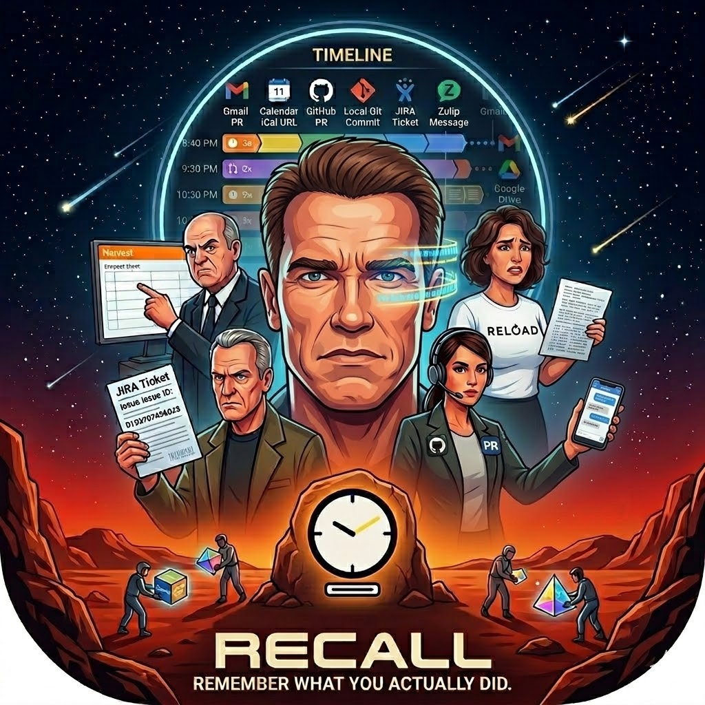
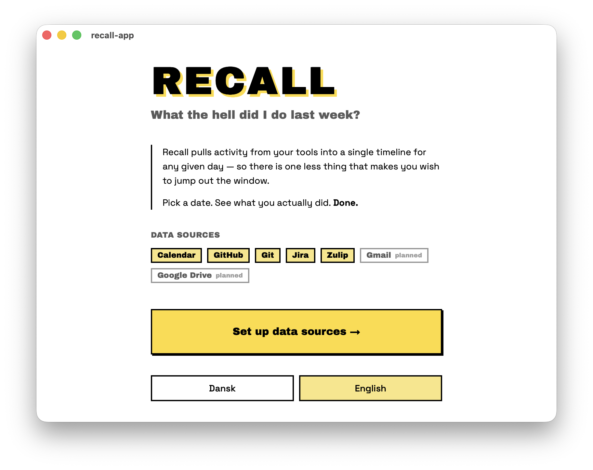
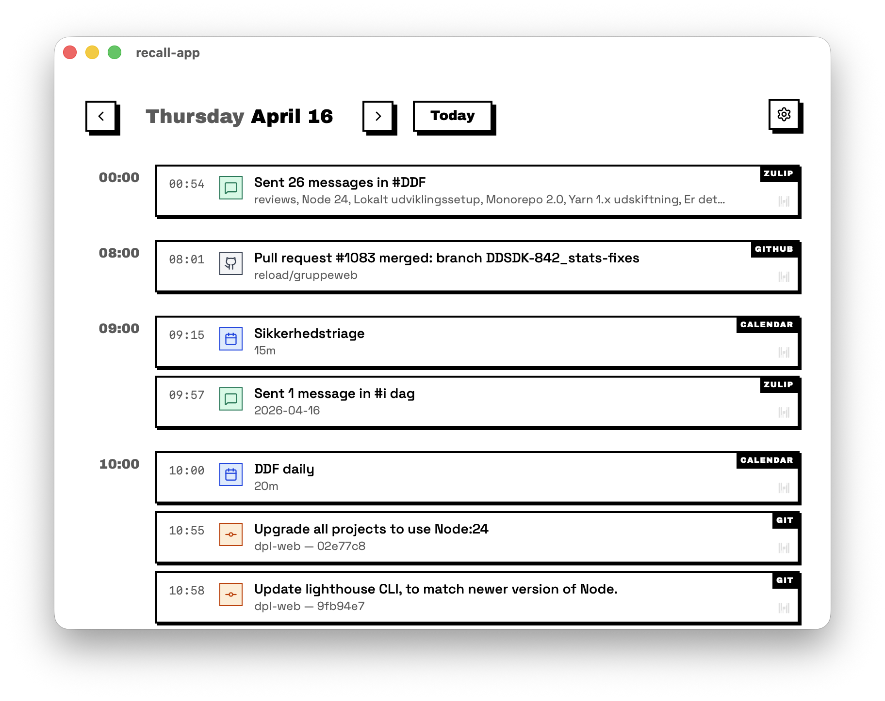
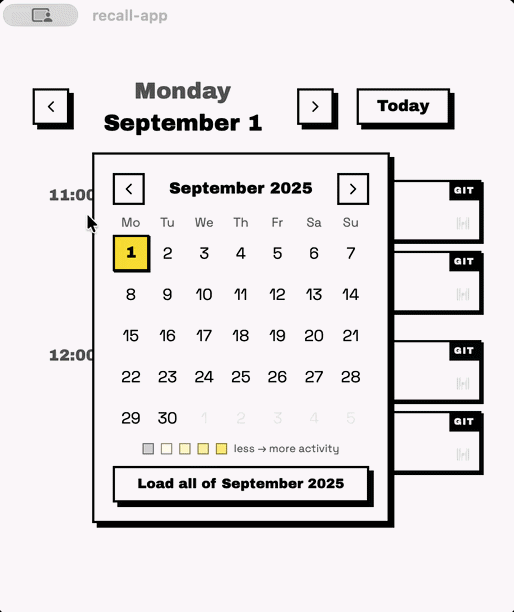

  <table width="100%">
    <tr>
      <td align="top" width="65%">
  <h1>Recall App</h1>
  A desktop app that builds a timeline of your prior workdays so you can fill in Harvest losing your mind.<br/><br/>
  Pick a date, and Recall pulls your activity from multiple sources into one view.<br/><br/>

  **Calendar**, **GitHub**, **Local git commits**, **JIRA**, **Zulip**, and more planned.
      </td>
      <td align="top" width="35%">
        
      </td>
    </tr>
  </table>
  
  <table>
    <tr>
      <td width="36%"></td>
      <td width="36%"></td>
      <td width="30%"></td>
    </tr>
  </table>

## Install

| Platform | Link |
|----------|------|
| macOS (Apple Silicon) | [Recall-macOS-AppleSilicon.dmg](https://github.com/rasben/recall-app/releases/latest/download/Recall-macOS-AppleSilicon.dmg) |
| macOS (Intel) | [Recall-macOS-Intel.dmg](https://github.com/rasben/recall-app/releases/latest/download/Recall-macOS-Intel.dmg) |
| Windows | [Recall-Windows.exe](https://github.com/rasben/recall-app/releases/latest/download/Recall-Windows.exe) · [Recall-Windows.msi](https://github.com/rasben/recall-app/releases/latest/download/Recall-Windows.msi) |
| Linux | [Recall-Linux.AppImage](https://github.com/rasben/recall-app/releases/latest/download/Recall-Linux.AppImage) · [Recall-Linux.deb](https://github.com/rasben/recall-app/releases/latest/download/Recall-Linux.deb) · [Recall-Linux.rpm](https://github.com/rasben/recall-app/releases/latest/download/Recall-Linux.rpm) |

## Development

This app has built almost entirely with AI.
First with `cursor`, then with `Claude Code`.

I have also experimented with AI-design for the logo.
[See the process here](https://rasben.github.io/recall-app/design/logo/preview/)

```
nvm use
npm install
npm run tauri dev
```

### Tech-Stack

- Svelte 5 + SvelteKit 3
- Tauri 2
- Rust backend
- SQLite for settings/credentials.

## Command line (`recall`)

`recall` prints your timeline for a day or range, using the data sources and credentials you set up in the app. It is meant for scripts and AI agents: they get the merged timeline without being handed your GitHub / Jira / Zulip tokens.

How to get it:

- **macOS:** in Recall, open **Settings → System → Command line** and click **Install the recall command**. It links `/usr/local/bin/recall` to the copy inside the app, and macOS may ask for your password. Recall has to be in your Applications folder first.
- **Linux (.deb / .rpm):** installed with the app as `/usr/bin/recall`. The AppImage runs from a temporary folder, so it can't provide the command.
- **Windows:** not available yet.
- **From a checkout:** `npm run cli:install` builds it into `~/.cargo/bin`:

```
npm run cli:install
```

```
recall timeline                              # yesterday, as JSON
recall timeline --date last-workday --format markdown
recall timeline --from last-workday --to yesterday   # on a Monday: Friday to Sunday
recall timeline --date last-workday --format markdown --with-prompt   # headed by your AI export prompt
recall timeline --from 2026-10-26 --to yesterday
recall help
```

Each event has a `logged` flag: whether you have ticked it off as logged in Harvest in the app. Exit status `2` means the timeline was printed but some sources failed (they are listed under `errors`), so it is incomplete. Before reading, it re-fetches your iCal feeds unless they were synced in the last 15 minutes (`--no-calendar-sync` skips that). `--with-prompt` starts the output with your AI export prompt from **Settings → AI**, exactly like the app's "Add a prompt intro"; `--lang da` picks the Danish built-in prompt when you haven't written your own.

### Daily Harvest overview with Claude

On macOS and with the Linux .deb/.rpm, the setup guide's last step (or **Settings → AI → Daily overview with Claude**) does this for you: it adds a `recall-harvest` skill to Claude, allows Claude to run `recall timeline` without asking, and opens Claude with a request to schedule the overview on weekday mornings (or to update the task, if you run it again). You check that request and press Enter. The overview follows your AI export prompt, so editing that prompt changes the next morning's overview too, and each run names its session after the day it covers, e.g. `Harvest · Tue 28 Oct 2026 · BUPL security day`.

To do it by hand, create a scheduled task in the Claude desktop app (a local one: a cloud routine cannot reach a program on your machine) that runs every weekday morning, with a prompt along the lines of:

> Run `recall timeline --from last-workday --to yesterday --format markdown --with-prompt` and follow the instructions at the top of its output (on a Monday that covers Friday to Sunday, so weekend work is included; leave out days with no activity). Skip events marked as logged in Harvest. If the exit status is 2, say which sources failed.

Allow the task to run `recall timeline` and nothing else. The CLI is what keeps your credentials away from Claude, but they are still in plain text in the app's database (see the security warning below), so a session that may run arbitrary shell commands could read them directly.

## Telemetry

Recall sends **one anonymous usage summary per day** so I can tell whether anyone uses the app and which features matter. There is no opt-out: nothing in it can identify you, and the list below is the complete contract.

**What is sent, once a day:**

- A random install ID (UUID generated at first launch), the date, app version, OS family and CPU architecture (e.g. `macos/aarch64`), UI language, theme, current grouping mode, and how long ago the app was installed (bucketed: `0to7d`, `8to30d`, …).
- A configuration snapshot as **booleans and buckets only**: which sources are enabled, which GitHub / Jira event types are opted in, how many calendar URLs are configured (`0`, `1`, `2`, `3plus`), and whether a custom export prompt is set.
- **Counters** accumulated since the previous summary: launches, setup-guide steps reached (and whether it was finished or skipped), days viewed, navigation clicks, grouping-mode switches, source-filter toggles, Harvest check marks, exports (format and preset), `recall` timeline runs, "Set up with Claude" and `recall` command install/uninstall outcomes (succeeded/failed), outbound link clicks per source, settings saves and test-connection outcomes per source, cache clears, and update-toast interactions.
- **Health counters**: per-source fetch duration buckets (`lt1s`, `1to3s`, `3to10s`, `gt10s`), per-source event-count buckets per loaded day (`0`, `1to10`, `11to50`, `50plus`), per-source error *classes* (`auth`, `rate_limit`, `network`, `config`, `other`), and calendar sync ok/fail counts.

**What is never sent:** titles, URLs, repository names or paths, ticket keys, usernames, emails, calendar summaries, hostnames, error message text, your timezone, or any timestamp finer than the calendar day. The server does not log IP addresses.

The full implementation is in [`src-tauri/src/telemetry.rs`](./src-tauri/src/telemetry.rs) (the `build_payload` function is exactly what leaves the machine, and a test asserts it contains no settings values) and the server side in [`worker/src/index.js`](./worker/src/index.js).

## Security warning

> ⚠️ **Your API tokens are stored in plain text.** - just like every other app does..
>
> GitHub / Jira / Zulip tokens and iCal secret URLs are saved unencrypted in the SQLite file under the app-data directory (e.g. `~/Library/Application Support/com.recall-app.app/db.sqlite` on macOS). Anything running as your user — a malicious npm postinstall script, a rogue VS Code extension, a cloud-synced backup on a stolen laptop — can read them.
>
> If that matters to you, use tokens with the narrowest scope you can, and treat them as rotatable.

## To-Do's

See [TODO.md](./TODO.md) for the roadmap and ideas list.
